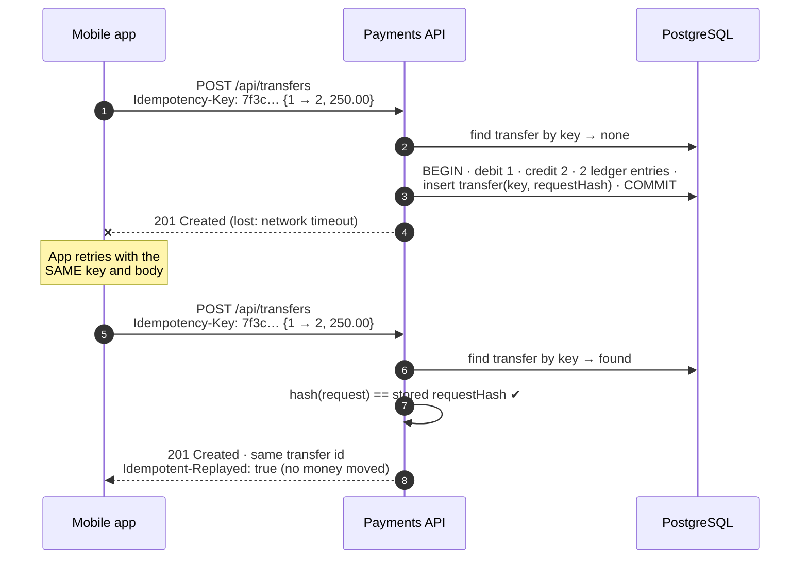

<div align="center">

# Exactly-Once Payments

**A banking transfer API that moves money exactly once, even when clients retry and requests race.**

[](https://github.com/DiyarSari/exactly-once-payments/actions/workflows/ci.yml)


[](LICENSE)

</div>

---

## Highlights

- **Exactly-once transfers.** An `Idempotency-Key` plus a stored request hash means retries and double taps never move money twice.
- **No overdrafts under load.** Optimistic locking (`@Version`) with a bounded, jittered retry. Proven by a test that fires **50 parallel transfers** at one account.
- **Deadlock-free by design.** Rows are always locked in ascending id order, so opposing transfers (A→B and B→A at once) cannot block each other.
- **Double-entry ledger.** Every transfer books one DEBIT and one CREDIT in a single transaction. The ledger always sums to zero, and every balance can be rebuilt from it.
- **Tested against real PostgreSQL.** 84 tests, with integration tests on Testcontainers rather than H2 or mocks. CI runs on every push.

## The Problem

Moving money looks like two lines of code: subtract here, add there. In production it breaks in two ways.

**💥 Duplicate transfers.** Ayşe sends 250 TRY rent from her mobile app. The bank moves the money, but the response is lost in a train tunnel. The app **retries after the timeout**, or Ayşe **taps "Send" again**. Without protection, the landlord receives 500 TRY.

**🏎️ Race conditions.** Ayşe has 1,000 TRY. A standing order and a card payment of 800 TRY each arrive at the same millisecond. Both read `balance = 1000`, both pass the check, and both subtract. The result is an overdrawn account or a debit that silently disappears (a *lost update*).

This project implements the techniques that payment providers such as Stripe and Adyen, and PSD2 bank APIs, use to prevent both.

## How It Works

### 1. Idempotency keys: same request, same result

The client generates one key (usually a UUID) per **logical** transfer and sends it on every retry.

| Request | Response |
|---|---|
| New key | Transfer runs; the outcome is stored with the key |
| Same key + same body | **Stored result returned**, no money moved, header `Idempotent-Replayed: true` |
| Same key + different body | `422 Unprocessable Entity` (one key, two different intents) |
| No key | `400 Bad Request` |

- **Simultaneous duplicates:** the key column has a `UNIQUE` constraint. When two copies arrive at the same instant, only one `INSERT` can commit. The other transaction rolls back, including its balance changes, and returns the winner's result.
- **"Same body" means the same transfer:** the service stores a **SHA-256 of a canonical form** of the request (`from|to|amount|description`, amount normalised to 2 decimals), so `100` and `100.00` count as the same request.



### 2. Optimistic locking: no lost updates

Every balance change is a conditional update:

```sql
UPDATE accounts SET balance = ?, version = version + 1 WHERE id = ? AND version = ?
```

- **Conflict:** if another transaction got there first, zero rows match and the whole transaction rolls back.
- **Retry:** the service retries in a **fresh transaction** with fresh balances, up to 5 times with exponential backoff and full jitter.
- **Still losing:** the client receives `409 Conflict` and can safely retry **with the same key**.
- **Deadlock avoidance:** accounts are loaded in id order, and `hibernate.order_updates=true` flushes updates sorted by primary key.
- **Defence in depth:** PostgreSQL itself enforces `CHECK (balance >= 0)`.

### 3. Double-entry ledger: money is moved, never created

A completed transfer writes two immutable entries in **one transaction**, together with both balance updates and the transfer record:

```
transfer ef66…  250.00 TRY
  DEBIT   account 1   250.00   balance after 9,750.00
  CREDIT  account 2   250.00   balance after 5,250.00
```

These invariants are asserted after **every** integration test:

- Σ credits − Σ debits = **0** per currency
- each `COMPLETED` transfer has exactly one matching DEBIT and one CREDIT; each `REJECTED` transfer has none
- each balance = opening balance + its ledger entries
- no balance is negative

## Tech Stack

| Area | Choice |
|---|---|
| Language | Java 21 |
| Framework | Spring Boot 3.5 (Web, Data JPA, Validation, Actuator) |
| Database | PostgreSQL 17, Flyway migrations |
| API docs | springdoc-openapi / Swagger UI |
| Errors | RFC 7807 `ProblemDetail`, global exception handler |
| Testing | JUnit 5, AssertJ, Mockito, MockMvc, Testcontainers |
| Build & CI | Maven Wrapper, GitHub Actions |

## Quick Start

You need **Java 21** and **Docker**.

```bash
git clone https://github.com/DiyarSari/exactly-once-payments.git
cd exactly-once-payments

docker compose up -d        # PostgreSQL on localhost:5433
./mvnw spring-boot:run      # API on http://localhost:8080
```

👉 **Swagger UI: http://localhost:8080/swagger-ui.html**

Three demo accounts are seeded by a Flyway migration:

| id | Owner | IBAN | Balance |
|---|---|---|---|
| 1 | Ayşe Yılmaz | TR80 9999 9000 0000 0000 0000 01 | 10,000.00 TRY |
| 2 | Mehmet Demir | TR53 9999 9000 0000 0000 0000 02 | 5,000.00 TRY |
| 3 | Zeynep Kaya | TR26 9999 9000 0000 0000 0000 03 | 2,500.00 TRY |

> PostgreSQL is published on host port **5433** so it does not clash with a local installation. Override it with `DB_URL`, `DB_USERNAME` and `DB_PASSWORD`.

## API

| Method | Path | Description |
|---|---|---|
| `POST` | `/api/accounts` | Open an account with an initial balance |
| `GET` | `/api/accounts/{id}` | Account details and balance |
| `GET` | `/api/accounts/{id}/ledger?page=0&size=20` | Ledger entries, newest first |
| `POST` | `/api/transfers` | Transfer money (**requires `Idempotency-Key`**) |
| `GET` | `/api/transfers/{id}` | Transfer details |

### Send the same transfer twice: money moves once

```bash
curl -i -X POST http://localhost:8080/api/transfers \
  -H 'Content-Type: application/json' \
  -H 'Idempotency-Key: 7f3c2a10-demo-0001' \
  -d '{"fromAccountId":1,"toAccountId":2,"amount":250.00,"description":"Rent"}'
```

```http
HTTP/1.1 201
Idempotent-Replayed: false

{"id":"ef669db4-b14d-4a5d-a1af-bb92fe94e533","fromAccountId":1,"toAccountId":2,"amount":250.00,
 "currency":"TRY","description":"Rent","status":"COMPLETED","failureReason":null,...}
```

Run **the exact same command again**, as if the app retried:

```http
HTTP/1.1 201
Idempotent-Replayed: true

{"id":"ef669db4-b14d-4a5d-a1af-bb92fe94e533", ... "status":"COMPLETED" ...}   ← same transfer
```

```bash
curl -s http://localhost:8080/api/accounts/1   # "balance": 9750.00  (not 9500.00)
curl -s http://localhost:8080/api/accounts/2   # "balance": 5250.00  (not 5500.00)
```

### Same key, different body → 422

```bash
curl -i -X POST http://localhost:8080/api/transfers \
  -H 'Content-Type: application/json' \
  -H 'Idempotency-Key: 7f3c2a10-demo-0001' \
  -d '{"fromAccountId":1,"toAccountId":2,"amount":999.00}'
```

```json
{
  "type": "about:blank",
  "title": "Idempotency key reused",
  "status": 422,
  "detail": "Idempotency-Key '7f3c2a10-demo-0001' was already used with a different request body",
  "instance": "/api/transfers",
  "errorCode": "IDEMPOTENCY_KEY_REUSED"
}
```

### Insufficient funds → recorded as `REJECTED`

```bash
curl -s -X POST http://localhost:8080/api/transfers \
  -H 'Content-Type: application/json' -H 'Idempotency-Key: demo-0002' \
  -d '{"fromAccountId":3,"toAccountId":1,"amount":99999.00}'
# → {"status":"REJECTED","failureReason":"INSUFFICIENT_FUNDS", ...}
```

### Error responses

Every error is `application/problem+json` (RFC 7807) with a machine-readable `errorCode`:

| Status | When | `errorCode` |
|---|---|---|
| 400 | Missing `Idempotency-Key`, malformed JSON | `BAD_REQUEST` |
| 400 | Invalid fields (`amount ≤ 0`, more than 2 decimals, `from == to`, …); details in `errors` | `VALIDATION_FAILED` |
| 404 | Unknown account or transfer | `NOT_FOUND` |
| 409 | Lock retries exhausted (safe to retry with the same key) | `CONCURRENT_MODIFICATION` |
| 422 | Key reused with a different body | `IDEMPOTENCY_KEY_REUSED` |

## Testing

```bash
./mvnw verify    # 67 unit tests + 17 integration tests (Docker required)
```

| Suite | Proves |
|---|---|
| `AccountTest`, `TransferRulesTest` | Overdraft refusal, currency mismatch, exact scale-2 money |
| `RequestValidationTest` | Positive amounts, max 2 decimals, `from ≠ to`, ISO 4217 currency |
| `TransferServiceTest` | Retry on lock conflict, bounded attempts, duplicate-key race handling |
| `TransferControllerTest` | HTTP contract: 400 / 409 / 422 problems, replay header |
| `IdempotencyIT` | Same key twice → money moves **once**; different body → **422**; 10 *simultaneous* identical requests → one transfer |
| `ConcurrencyIT` | 50 parallel transfers; 40 opposing transfers without deadlock |
| `LedgerInvariantIT` | Runs last: the ledger sums to zero over everything the suite wrote |

### What the concurrency test proves

The test opens an account with **1,000.00 TRY** and releases **50 threads at the same instant** (`CountDownLatch`). Each thread sends a 100.00 TRY transfer over real HTTP, so 5,000 TRY of demand meets 1,000 TRY of funds:

```
50 parallel transfers: 10 completed, 40 rejected
```

- exactly **10 `COMPLETED`** and **40 `REJECTED`**: no more, no fewer
- final source balance is exactly **0.00**, never negative
- **total money in the system is unchanged**
- all ledger invariants still hold

Remove `@Version` and the same test fails: concurrent threads read the same balance, and either too many transfers complete or the database's `CHECK` constraint has to stop them.

## Design Decisions & Trade-offs

<details open>
<summary><b>Optimistic vs pessimistic locking</b></summary>

`SELECT … FOR UPDATE` never needs retries, but it holds row locks for the whole transaction and builds queues on busy accounts. Optimistic locking takes no locks while reading and only pays a cost on a real conflict, which suits the common case of transfers touching different accounts. The price is retries on a single hot account. Those retries are bounded, and the idempotency key makes a client retry after `409` safe. For a few extremely hot accounts (for example merchant settlement), switching that path to `PESSIMISTIC_WRITE` would be the pragmatic choice.
</details>

<details open>
<summary><b>Why BigDecimal</b></summary>

In binary floating point, `0.1 + 0.2 = 0.30000000000000004`. Money is `BigDecimal` end to end and `NUMERIC(19,2)` in the database, normalised with `RoundingMode.UNNECESSARY`, so an amount that would need rounding is an error and is never silently changed.
</details>

<details open>
<summary><b>Why store a request hash</b></summary>

Without it, a client that accidentally reuses a key for a *different* transfer would get the old result back and believe the new transfer succeeded. Comparing hashes turns that silent bug into an explicit `422`. The hash is computed from the parsed values, not the raw bytes, so formatting differences do not cause false conflicts, and the stored value has a fixed size.
</details>

<details>
<summary><b>More decisions</b></summary>

- **Rejections are stored.** `INSUFFICIENT_FUNDS` and `CURRENCY_MISMATCH` are saved as `REJECTED`, and replaying the key returns the same rejection: the key identifies an attempt whose outcome is already decided. Invalid requests (400) and unknown accounts (404) are not stored, so the client can fix the request and reuse the key.
- **Retry loop outside the transaction.** `TransferService` loops around the `@Transactional` `TransferProcessor`, so every attempt gets a fresh persistence context. `open-in-view` is disabled for the same reason.
- **Timestamps truncated to microseconds** to match PostgreSQL, so a replayed response is byte-identical to the original. CI on Linux caught this; macOS clocks hide it.
- **Opening balances** are stored on the account rather than as ledger entries against a funding account. This keeps the demo focused while every balance stays reconcilable.
- **Ids:** sequential `BIGINT` for accounts (readable, natural lock order), random UUIDs for transfers (not guessable).
- **IBANs** use the Turkish format with valid mod-97 check digits and a fictional bank code `99999`.
- **Idempotency keys** are globally unique here; a multi-tenant system would scope them per client.
</details>

## Project Structure

```
src/main/java/com/diyarsari/transfer
├── controller/   REST endpoints (accounts, transfers)
├── service/      TransferService (retry loop) · TransferProcessor (one transaction) · RequestHasher
├── domain/       Account · Transfer · LedgerEntry · TransferRules (pure business rules)
├── repository/   Spring Data JPA repositories
├── dto/          Request/response records with Bean Validation
├── exception/    Domain exceptions + RFC 7807 GlobalExceptionHandler
└── config/       Retry settings, OpenAPI
src/main/resources/db/migration   Flyway schema + demo seed
```

## Possible Improvements

- **Transactional outbox:** publish `TransferCompleted` events to Kafka reliably, with no lost or duplicate events.
- **Multi-currency:** FX quotes with expiry and a currency-exchange ledger account.
- **Idempotency key expiry:** keep keys for 24–72 h, then archive them.
- **Auth:** Spring Security with OAuth2/JWT; only owners can debit; keys scoped per client.
- **Rate limiting:** per client and per account (Bucket4j or an API gateway).
- **Observability:** Micrometer metrics for retries, conflicts and replays; OpenTelemetry tracing.

## License

[MIT](LICENSE) © Diyar Sari
